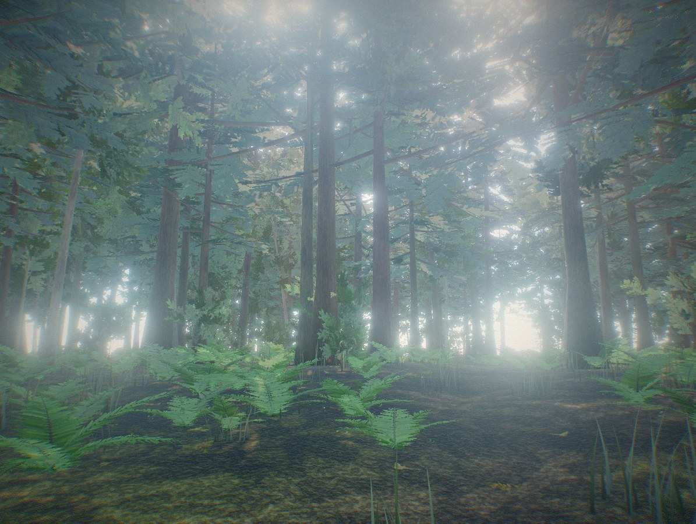

# forest-world-builder

A procedurally generated wood that runs in the browser. Five Blender primitives, four verbs and a handful of
field rules grow everything; nothing is placed by hand.

**Walk it: [forest.spectrumaura.org](https://forest.spectrumaura.org/).**
How it works, with live illustrations: [How the wood grows](https://forest.spectrumaura.org/how-the-wood-grows.html)
(source in `docs/how-the-wood-grows.html`).

## Run

    npm install
    npx vite --host --port 5199 --strictPort   # dev server, reachable on the local network
    npm run build                              # production build into dist/ (about 2.0 MB)

    npm run assets                             # rebuild public/ from blender/build.py (Blender 5.2, ~40 s)

Every push to `main` builds and publishes to GitHub Pages (`.github/workflows/pages.yml`).

## Address parameters

| Parameter | Effect |
|---|---|
| `seed=7` | which wood (default 1; R or a three-finger tap picks another) |
| `hour=22` | hold the clock at this hour; `hour=now` keeps your own local time; without it a day lasts six minutes from a random start |
| `rain=1` | force rain (`0` keeps it dry); without it showers come and go |

The clock in the top right corner switches between the six-minute day and your own time (or press T); the choice is remembered. F goes full screen and back.
Clouds drift at their own slow pace in either mode. The walk sets out about a minute short of the first meadow the path crosses.
Trunks, boulders, logs, stumps and bushes are solid to the walker and to every beast, which also keep clear of each other; birds and insects fly round trunks.
Look for foxgloves at the meadow edge, rabbits in tall grass and a buzzard circling above the canopy. In [afternoon rain](https://forest.spectrumaura.org/?rain=1&hour=14), nearby drops streak past and the ground takes on a sheen.
On a [night walk](https://forest.spectrumaura.org/?seed=3&hour=23), deer notice you from farther away. Watch for two pale pinpricks as one lifts its head and faces you. Move closer and it bolts.

## Layout

| File | Holds |
|---|---|
| `src/noise.js` | seeded hash, noise, fbm |
| `src/world.js` | fields, height, the layer table, scatter and refill; how birds fly and beasts graze, follow and bolt |
| `src/forms.js` | sweep, lump, card, paint; the tree recursion; flora, insects, birds and the one quadruped that makes deer, rabbit and fox |
| `src/look.js` | materials, sun and moon clock, mist and shafts, rain, lens |
| `src/main.js` | boot, walking (mouse, keys, touch), the frame loop |
| `blender/build.py` | primitives, sprig atlas, bark, rock and ground maps |

## Where the frame goes

Measured on a Mac at 1792 x 1350, a frame is about 14 ms. Triangles are not the limit (the trees are 14 million a
frame and cutting most of them saves under 1 ms); filling pixels is. So the fog is marched at half size and laid
over the scene by depth, the bloom runs at half size, and the sun's shadow map is redrawn every other frame.
Before those three the same frame took 24 ms.

## Not yet checked

- Rain was only viewed at 14:00 on one seed, in still frames: not at night or dusk, not in a meadow, and the splash flecks on the ground were not picked out.
- Animals in rain. At night the eye shine and the bolt were seen for deer only, not rabbit or fox.
- Collisions were measured for beasts (1,833 positions sampled while a herd bolted: none more than 4 cm inside anything solid, none stuck). The walker and the fliers use the same test but were not watched.
- The rabbit was only seen through grass after its last changes.
- Shafts and dusk after the bloom was restricted to what outshines an open sky (it used to veil meadows white): only daytime views were compared.
- The frame rate after the animals and the new ground layers was only seen to hold this Mac's 144 Hz display at 1195 x 808; how much room is left was not measured.

- Frame rate on a real phone. On a Mac it is about 70 fps at 1195 x 900; Chrome's phone emulation (390 x 844, touch, CPU slowed 4x)
  holds that at the 1.25 pixel ratio, which clears the script side but says nothing about a phone's GPU.
- The moon's disc itself: the canopy hid it wherever it was looked for. Moonlight, stars and dusk are checked.
